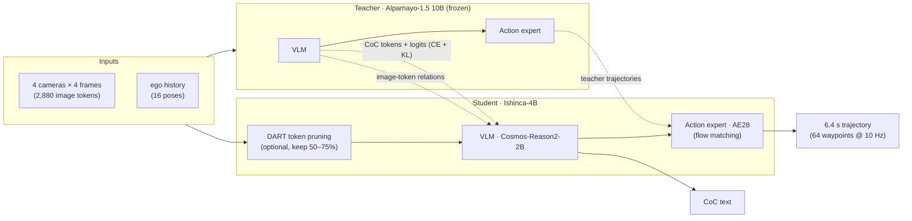

<div align="center">

# ⛰️ Ishinca

### Distilling NVIDIA Alpamayo 1.5 (10B) into a 4B Vision-Language-Action Model for Autonomous Driving

**Sunguk Kim**

[](#-model-zoo)
[](LICENSE)
[](NOTICE)
[](pyproject.toml)

*Ishinca is the friendly, beginner-accessible summit of Peru's Cordillera Blanca — the same range as Alpamayo, just a gentler climb.*

</div>

---

## TL;DR

**Ishinca-4B** is a 4.2B-parameter student of NVIDIA's [Alpamayo-1.5-10B](https://huggingface.co/nvidia/Alpamayo-1.5-10B)
end-to-end driving VLA. From 4 cameras × 4 frames and the ego history it produces a natural-language
**Chain-of-Causation (CoC)** explanation and a **6.4 s trajectory**, like its teacher.
In closed-loop simulation (AlpaSim, 150 scenes) it drives on par with the 10B teacher, and its DART variants
prune 25–50% of the vision tokens without losing closed-loop score.

<div align="center">

| | Alpamayo-1.5 (Teacher) | Ishinca-4B | Ishinca-4B-DART75 | Ishinca-4B-DART50 |
|---|:---:|:---:|:---:|:---:|
| Parameters | 10B | 4.2B | 4.2B | 4.2B |
| Open-loop minADE6@6.4s ↓ · our val set¹ | 0.826 | 0.986 | 0.994 | 1.003 |
| Open-loop minADE6@6.4s ↓ · gold644² | 0.831 | 1.045 | — | — |
| Closed-loop score ↑ · AlpaSim 150 scenes | 0.728 | 0.751 | 0.731 | 0.776 |

</div>

<sub>¹ Held-out validation set we built from PhysicalAI-AV (4,000 samples, not used for training), vs ground truth.
² The 644 public PhysicalAI-AV evaluation examples of **Table 10 (§6.4 Public Benchmark Evaluation)** in the
Alpamayo-R1 paper ([arXiv:2511.00088](https://arxiv.org/abs/2511.00088)), clip list from NVIDIA's public recipe;
measured by us with the official protocol (the paper reports 0.849 m for Alpamayo-R1-10B on this set).
Closed-loop differences among the four models are within run-to-run noise (paired scene bootstrap, 2 rollouts per scene).
The released checkpoints are distillation-only; no reinforcement learning (GRPO) is applied (see [Roadmap](#-roadmap)).</sub>

## 📰 News

- **2026-11** — Code, evaluation protocol and the three Ishinca-4B checkpoints released.

## 🔍 Overview

End-to-end driving VLAs such as Alpamayo reason in language before they act, but at 10B parameters with ~2.9k image
tokens per call they are hard to deploy on in-vehicle computers. Ishinca asks a simple question: **how much of the teacher
survives when the whole model — reasoning and action — is distilled into a much smaller VLA, and how far can we then cut
the visual input?**



**Key ingredients**

- 🧠 **Teacher-only supervision.** Every distillation target — CoC text, token distributions and trajectories — comes
  from the teacher; no ground-truth trajectories are mixed into the targets. The goal is to close the *teacher gap*.
- 🔗 **Relation distillation.** Besides CE/KL on the teacher's CoC, the student matches the teacher's
  *relations between image tokens*, which transfers how the teacher organises the scene instead of forcing
  incompatible hidden sizes to align. The VLM is fully fine-tuned from Cosmos-Reason2-2B.
- 🎯 **AE28 action expert.** A 28-layer flow-matching expert initialised from evenly spaced teacher-expert layers and
  trained on the distilled VLM's own prefix (CoC + image KV), so the expert reads what the student actually produces.
- ✂️ **DART vision-token pruning.** [DART](https://arxiv.org/abs/2502.11494) keeps a diverse subset of merged image
  tokens (pivots + duplicate removal) while preserving their original mRoPE positions; the student is then retrained so
  the action expert adapts to the shorter KV. 50% pruning cuts Jetson Thor prefill from 94.2 → 41.4 ms.

## 🏆 Results

### Closed loop — AlpaSim, 150 scenes × 2 rollouts, all models on the same runtime

Score = 0 on an at-fault collision or off-road event, otherwise `min(progress / 0.8, 1)`, averaged over all 150 scenes
(scene lists in [`eval/closedloop/scenes`](eval/closedloop/scenes)).

| | Teacher 10B | Ishinca-4B | Ishinca-4B-DART75 | Ishinca-4B-DART50 |
|---|:---:|:---:|:---:|:---:|
| Score ↑ | 0.728 | 0.751 | 0.731 | 0.776 |
| Failed rollouts / 300 ↓ | 40 | 37 | 45 | 37 |
| ├ off-road | 32 | 34 | 35 | 30 |
| └ at-fault collision | 8 | 3 | 10 | 7 |

The differences among the four models are within run-to-run noise (paired scene bootstrap, 2 rollouts per scene), so
the ranking above should not be read as one model being better: the 4B student drives like the 10B teacher.

### Open loop

**Our validation set** — 4,000 held-out PhysicalAI-AV samples we built (not used for training); same initial noise for
every model, flow-matching expert with 10 Euler steps.

| Model | Image tokens | vs GT: ADE | vs GT: minADE6@6.4s | vs Teacher: ADE | vs Teacher: FDE | vs Teacher: minADE6@6.4s |
|---|:---:|:---:|:---:|:---:|:---:|:---:|
| Teacher 10B | 2,880 | 1.750 | 0.826 | — | — | — |
| Ishinca-4B | 2,880 | 1.957 | 0.986 | 1.041 | 3.172 | 0.670 |
| Ishinca-4B-DART75 | 2,160 | 1.957 | 0.994 | 1.043 | 3.173 | 0.686 |
| Ishinca-4B-DART50 | 1,440 | 1.972 | 1.003 | 1.068 | 3.250 | 0.698 |

**gold644** — the 644 public PhysicalAI-AV evaluation examples of the Alpamayo-R1 paper,
**Table 10, §6.4 Public Benchmark Evaluation** ([arXiv:2511.00088](https://arxiv.org/abs/2511.00088)), using the clip list
of NVIDIA's public evaluation recipe and the official protocol (t0 = 5.1 s, 6 samples, T = 0.6, top-p 0.98, no navigation).

| Model | ADE (1 sample) | minADE6@6.4s |
|---|:---:|:---:|
| Alpamayo-R1-10B *(reported in the paper, Table 10)* | — | 0.849 |
| Alpamayo-1.5-10B (Teacher, measured by us) | 2.241 | 0.831 |
| Ishinca-4B (measured by us) | 2.381 | 1.045 |

Clip IDs and per-clip teacher references: [`eval/openloop/manifests`](eval/openloop/manifests); protocol:
[`eval/openloop/PROTOCOL.md`](eval/openloop/PROTOCOL.md); details: [`docs/results.md`](docs/results.md).

### Deployment (model compute only, full 16-frame window)

| Platform | Configuration | Latency |
|---|---|:---:|
| RTX 5090 | FP8 vision (QAD) + FP8 LLM (PTQ), streaming, 4-step action expert | 93.6 ms (p95 98.5) |
| Jetson AGX Thor | TensorRT Edge-LLM, NVFP4 4-step expert + INT8 LM head + GQA plugin | 383.3 ms |
| Jetson AGX Thor | DART50, FP8 10-step expert (vs 498.1 ms without DART) | 401.8 ms |
| RTX 3090 (x86) | this repo, eager PyTorch bf16, 8.0 GiB peak VRAM | ~1.1 s |

The optimised runtimes (FP8/NVFP4 engines, streaming, 4-step expert) are research artefacts and are **not** part of this
release; the released checkpoints use the 10-step expert and run with the eager PyTorch code below.

### What still goes wrong

Failures are scene-systematic and shared with the teacher (14 scenes fail for all four models). The plan — not the
controller — is the cause (tracking error ≤ 0.01 m): turns cutting corners, route ambiguity at junctions and driveways
(**no navigation input**), lane-keeping drift, and nudging around stopped vehicles. DART variants show a non-significant
trend towards more at-fault collisions (150-scene run: Teacher 8 / Ishinca-4B 3 / DART50 7 / DART75 10; 9-scene rerun ×6:
10 / 11 / 19 / 21).

## 🤗 Model Zoo

| Model | Vision tokens | DART keep | Weights |
|---|:---:|:---:|---|
| Ishinca-4B | 2,880 | — | [`suukim/Ishinca-4B`](https://huggingface.co/suukim/Ishinca-4B) |
| Ishinca-4B-DART75 | 2,160 | 0.75 | [`suukim/Ishinca-4B-DART75`](https://huggingface.co/suukim/Ishinca-4B-DART75) |
| Ishinca-4B-DART50 | 1,440 | 0.50 | [`suukim/Ishinca-4B-DART50`](https://huggingface.co/suukim/Ishinca-4B-DART50) |

Each checkpoint is a single bf16 `model.safetensors` (VLM 2.45B + action expert 1.77B parameters) plus the tokenizer and
processor files; DART checkpoints store their keep ratio in `config.json` (`ishinca_dart_keep`).

## 🚀 Getting Started

### Install

```bash
git clone https://github.com/kimsunguk0/Ishinca && cd Ishinca
pip install "git+https://github.com/NVlabs/alpamayo1.5.git" physical_ai_av   # upstream inference code (Apache-2.0)
pip install -e .
```

`transformers==4.57.1`, PyTorch ≥ 2.6 with CUDA, ~8 GiB GPU memory. Tested on x86 (RTX 3090, torch 2.8 / CUDA 12.8) and
aarch64 (RTX 5090, torch 2.9.1) — see [`docs/validation_x86.md`](docs/validation_x86.md). Docker: `docker build -t ishinca .`

### Inference

```bash
hf download suukim/Ishinca-4B --local-dir ./Ishinca-4B

# one PhysicalAI-AV clip (gated dataset, see data/README.md)
python scripts/infer.py --checkpoint ./Ishinca-4B --clip-id 030c760c-ae38-49aa-9ad8-f5650a545d26 --seed 42
python scripts/infer.py --checkpoint ./Ishinca-4B-DART50 --clip-id <uuid>      # DART keep read from config.json
```

```python
import torch
from ishinca import load_ishinca, build_model_inputs
from ishinca.data import load_clip
from ishinca.inputs import get_processor

model = load_ishinca("suukim/Ishinca-4B")                  # local dir or HF repo id
processor = get_processor(model)
data = load_clip("<clip-id>", t0_us=5_100_000)          # 4 cams × 4 frames + ego history
inputs = build_model_inputs(model, processor, data["image_frames"], data["camera_indices"],
                            data["ego_history_xyz"], data["ego_history_rot"])
torch.manual_seed(42)
with torch.autocast("cuda", dtype=torch.bfloat16):
    xyz, rot, extra = model.sample_trajectories_from_data_with_vlm_rollout(
        data=inputs, top_p=0.98, temperature=0.6, num_traj_samples=1,
        max_generation_length=256, return_extra=True)

print(extra["cot"][0, 0, 0])   # e.g. "Nudge to the right to clear the construction barrels blocking the left side of our lane"
print(xyz[0, 0, 0, :, :2])     # 64 × 2 waypoints, ego frame at t0, metres
```

## 📏 Evaluation

| | Where | What you get |
|---|---|---|
| Open loop | [`eval/openloop`](eval/openloop) | protocol, ADE / FDE / minADE6 vs GT and vs Teacher, gold644 manifest + teacher references, teacher-reference generation |
| Closed loop | [`eval/closedloop`](eval/closedloop) | AlpaSim driver plugin + configs, remote-driver topology, 150-scene list, scoring and re-aggregation that reproduces the table above |
| Data | [`data/README.md`](data/README.md) | how to obtain PhysicalAI-AV and the expected directory layout (no data is redistributed) |

## 🗂️ Repository Layout

```
ishinca/            model (Alpamayo1_5 subclass with the student tokenizer), loader, inputs, DART, clip loading
scripts/infer.py  frames + ego history → CoC text + 6.4 s trajectory
eval/openloop/    protocol, metrics, runners, manifests
eval/closedloop/  AlpaSim plugin, configs, topology, scene lists, scoring
docs/             results and validation logs
tests/            DART unit tests, rollout-parity test (GPU)
```

Ishinca does not copy NVIDIA's code: `IshincaModel` subclasses `alpamayo1_5.Alpamayo1_5` and only swaps in the student
tokenizer. Without DART the upstream rollout runs unchanged; with DART an explicit rollout (prefill → CoC decode →
upstream flow-matching expert) is used, bit-identical to upstream when nothing is pruned.

## ⚠️ Limitations

- Research release — **not** a production driving system and not validated on real vehicles at scale.
- No navigation/route input: at junctions the model picks a plausible route, not necessarily the intended one.
- Closed-loop results use non-reactive replayed traffic; at-fault labels are imperfect when the ego is slower than the log.
- Trained and evaluated on PhysicalAI-AV camera rigs; camera mounting/calibration changes shift the predicted path.

## 🔭 Roadmap

- **Goal: 10 FPS on Jetson AGX Thor.** The target is to run the VLA on Jetson AGX Thor at 10 FPS (100 ms per call).
  The current best full-window Thor latency is 383.3 ms (model compute only, see [Deployment](#deployment-model-compute-only-full-16-frame-window)),
  so the remaining work is mainly on the deployment side: vision tokens, prefill, CoC decoding and action-expert steps,
  then streaming.
- **Reinforcement learning (GRPO).** We are still studying reinforcement learning for driving VLAs. GRPO on the VLM
  is the next step we plan to apply to Ishinca; early experiments are under way but are not part of this release.
  **The released checkpoints do not use VLM GRPO** — they are trained by distillation from the teacher only.
- **Further training and experiments** (GRPO, navigation-conditioned evaluation, larger closed-loop studies) will
  continue once GPU resources for training are available again.

## 📖 Citation

```bibtex
@misc{kim2026ishinca,
  title        = {Ishinca: Distilling Alpamayo 1.5 (10B) into a 4B Vision-Language-Action Model for Autonomous Driving},
  author       = {Kim, Sunguk},
  year         = {2026},
  howpublished = {\url{https://github.com/kimsunguk0/Ishinca}}
}
```

## 🙏 Acknowledgements

Ishinca stands on the shoulders of
[NVIDIA Alpamayo 1.5](https://github.com/NVlabs/alpamayo1.5) (teacher and inference code),
[NVIDIA Cosmos-Reason2](https://huggingface.co/nvidia/Cosmos-Reason2-2B) (student backbone),
[Qwen3-VL](https://github.com/QwenLM/Qwen3-VL) (architecture and tokenizer),
[AlpaSim](https://github.com/NVlabs/alpasim) (closed-loop simulation),
the PhysicalAI-AV dataset, and
[DART](https://arxiv.org/abs/2502.11494) (token pruning).

## 📄 License

- **Code**: Apache License 2.0 ([`LICENSE`](LICENSE)).
- **Weights**: NVIDIA Open Model License (backbone derived from Cosmos-Reason2-2B); teacher-derived parts from
  Alpamayo-1.5-10B (OpenMDW-1.1); tokenizer files from Qwen3-VL (Apache-2.0). See [`NOTICE`](NOTICE).
- **Data**: PhysicalAI-AV is governed by NVIDIA's AV dataset license; nothing is redistributed here.

*Licensed by NVIDIA Corporation under the NVIDIA Open Model License. Built on NVIDIA Cosmos.*
